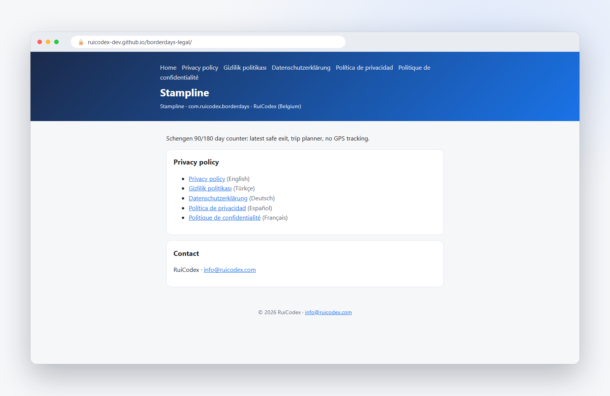
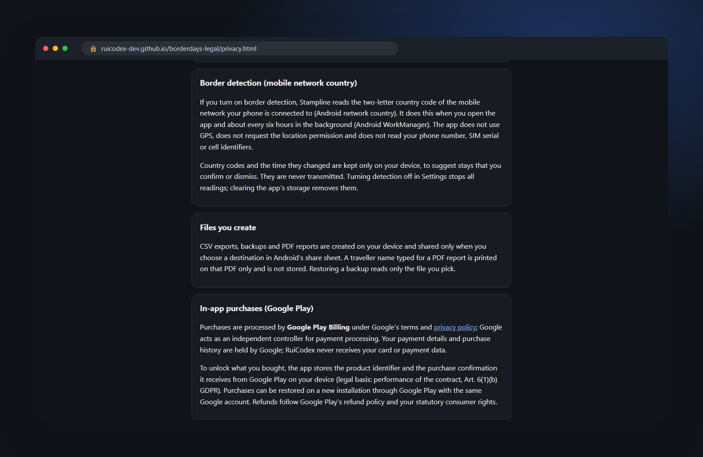
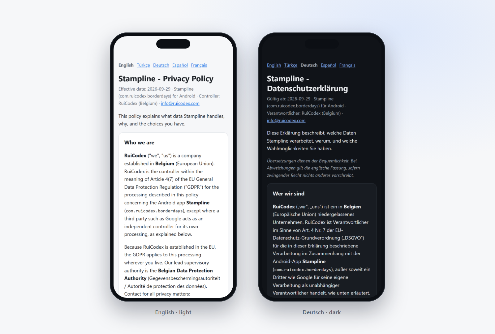
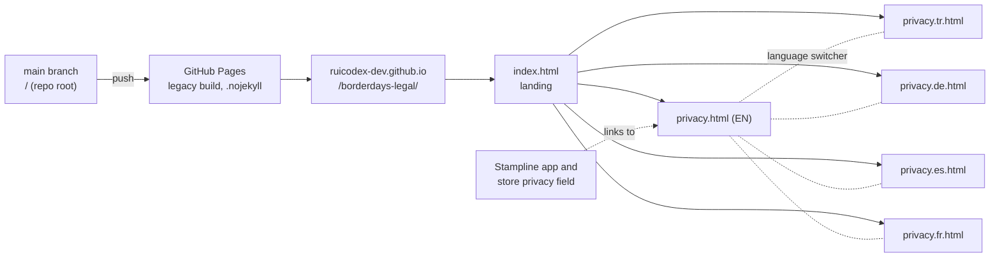

<div align="center">

<a href="https://ruicodex-dev.github.io/borderdays-legal/"></a>

<h3>The public legal home of <b>Stampline</b>, the Schengen 90/180 day counter for Android.</h3>

<p>One privacy policy, five languages, plain static HTML. No scripts, no trackers, nothing to break.</p>


<p>
<a href="https://ruicodex-dev.github.io/borderdays-legal/"><b>Live site</b></a> &nbsp;·&nbsp;
<a href="https://ruicodex-dev.github.io/borderdays-legal/privacy.html">Privacy policy</a> &nbsp;·&nbsp;
<a href="#the-pages">All languages</a> &nbsp;·&nbsp;
<a href="#editing-the-policy">Edit the policy</a> &nbsp;·&nbsp;
<a href="https://ruicodex.com">Rui Codex</a>
</p>

</div>

---

## Why this repo exists

Stampline counts Schengen days on a rolling 90/180 window, shows the latest safe exit and plans trips, without GPS tracking.
An app store listing needs a stable, public privacy-policy URL, and the people who use the app deserve a policy they can read
in their own language. This repository is exactly that: a small GitHub Pages site that serves the Stampline privacy policy
in **English, Turkish, German, Spanish and French**, plus a landing page that links them together.

It holds the legal pages only. Everything here is public on purpose.

## Highlights

<table>
<tr>
<td width="33%" valign="top">
<b>Five languages, one structure</b><br>
EN, TR, DE, ES and FR pages share the same 18 sections, the same effective date and a language switcher on every page.
</td>
<td width="33%" valign="top">
<b>Says what the app really does</b><br>
On-device storage, network-country border detection without GPS, local reminders, CSV/PDF/backup files and Google Play Billing, each in its own section.
</td>
<td width="33%" valign="top">
<b>Written for EU law first</b><br>
Controller established in Belgium, GDPR legal bases per purpose, Belgian DPA as lead authority, KVKK for Türkiye, UK, Swiss and US-state rights.
</td>
</tr>
<tr>
<td width="33%" valign="top">
<b>Zero JavaScript</b><br>
Every page is hand-written HTML with inline CSS. No script tag, no web font, no external stylesheet.
</td>
<td width="33%" valign="top">
<b>Light and dark</b><br>
Colours follow <code>prefers-color-scheme</code>, so the policy matches the reader's system theme on phone and desktop.
</td>
<td width="33%" valign="top">
<b>Mobile-first reading</b><br>
A responsive viewport, a 760 px reading column and card sections that stay comfortable at 390 px wide.
</td>
</tr>
</table>

## Screenshots

Real captures of the live site at `ruicodex-dev.github.io/borderdays-legal`.

<table>
<tr>
<td width="50%"></td>
<td width="50%"></td>
</tr>
<tr>
<td align="center"><sub><b>Landing page</b> · every language one tap away</sub></td>
<td align="center"><sub><b>Privacy policy, dark</b> · border detection explained without GPS</sub></td>
</tr>
<tr>
<td colspan="2"></td>
</tr>
<tr>
<td colspan="2" align="center"><sub><b>On a phone</b> · English in light mode, German in dark mode, at 390 px</sub></td>
</tr>
</table>

## The pages

| Language | Page | Live URL |
|---|---|---|
| Landing | `index.html` | https://ruicodex-dev.github.io/borderdays-legal/ |
| English | `privacy.html` | https://ruicodex-dev.github.io/borderdays-legal/privacy.html |
| Türkçe | `privacy.tr.html` | https://ruicodex-dev.github.io/borderdays-legal/privacy.tr.html |
| Deutsch | `privacy.de.html` | https://ruicodex-dev.github.io/borderdays-legal/privacy.de.html |
| Español | `privacy.es.html` | https://ruicodex-dev.github.io/borderdays-legal/privacy.es.html |
| Français | `privacy.fr.html` | https://ruicodex-dev.github.io/borderdays-legal/privacy.fr.html |

Effective date of the current policy: **2026-09-29**. The translated pages carry a short note that the English version
prevails where they differ, unless mandatory law says otherwise.

## What the policy covers

<details>
<summary><b>All 18 sections, in one line each</b></summary>

<br>

| # | Section | In short |
|---|---|---|
| 1 | Who we are | RuiCodex, established in Belgium, is the controller under GDPR Art. 4(7). |
| 2 | Summary | No account, data stays on the device, purchases via Google Play, no data sold. |
| 3 | Information stored on your device | Settings, history and entries live in app-private storage and are never sent to Rui Codex. |
| 4 | Border detection | Optional: reads the mobile network country code on open and about every 6 h. No GPS, no location permission. |
| 5 | Files you create | CSV exports, backups and PDF reports are made on the device and shared only where you choose. |
| 6 | In-app purchases | Google Play Billing; only the product id and purchase confirmation are kept on the device. |
| 7 | Notifications | Reminders are scheduled locally, not sent from a server. |
| 8 | Analytics | No analytics or crash-reporting service is used in the app. |
| 9 | Legal bases | Contract, legal obligation and legitimate interest, mapped to each purpose. |
| 10 | Who receives data | Google (billing), the email provider when you write in, authorities only when required. |
| 11 | International transfers | SCCs and the EU-U.S. Data Privacy Framework; KVKK Art. 9 for Türkiye. |
| 12 | Retention and deletion | App data stays until you delete it; support emails kept at most three years. |
| 13 | Your rights | GDPR Art. 15-21 and 7(3), KVKK Art. 11, UK/Swiss law, US-state rights; answer within one month. |
| 14 | Security | App-private Android storage; Google SDK traffic over HTTPS. |
| 15 | Children | For ages 13 and over; consent rules under GDPR Art. 8. |
| 16 | Applicable law and disputes | Belgian law with consumer protections (Rome I, Brussels Ia) and free mediation options. |
| 17 | Changes to this policy | The effective date marks the version; significant changes are also announced in the app or its release notes. |
| 18 | Contact | One address for every privacy matter. |

</details>

## How it works



Pages builds straight from the root of `main`. The empty `.nojekyll` file tells Pages to serve the files as they are, without
a Jekyll step. Each page is self-contained: CSS sits in a `<style>` block, so a page renders the same offline, in a store
review tool or in a phone's in-app browser.

## Tech stack

| Layer | Choice | Why |
|---|---|---|
| Markup | Hand-written HTML5, one file per language | Easy to diff, review and translate line by line |
| Style | Inline CSS with custom properties | Theme tokens for light and dark, no build step |
| Type | `system-ui` font stack | Native look on every device, no font download |
| Hosting | GitHub Pages from `main` / root | Stable HTTPS URL, rebuilds on every push |
| Scripts | None | Nothing to track, nothing to block, nothing to break |

## Editing the policy

**Preview locally.** Any static file server works. With Python installed:

```bash
git clone https://github.com/RuiCodex-dev/borderdays-legal.git
cd borderdays-legal
python -m http.server 8000
# open http://localhost:8000/
```

**Change the text.**

1. Edit `privacy.html` (English is the reference version).
2. Make the same change in `privacy.tr.html`, `privacy.de.html`, `privacy.es.html` and `privacy.fr.html`, so all five keep the same sections.
3. Update the effective date in the meta line of every page.
4. Commit and push to `main`. GitHub Pages republishes in a minute or two.

<details>
<summary><b>Adding a language</b></summary>

<br>

1. Copy `privacy.html` to `privacy.<code>.html` (for example `privacy.nl.html`) and set `<html lang="<code>">` and the `<title>`.
2. Translate the body and keep the translation note (`<p class="note">`) that says the English version prevails.
3. Add the new language to the `<nav class="langs">` switcher in **every** privacy page.
4. Add it to the header links and the list in `index.html`, with an `hreflang` attribute.
5. Preview locally, then push to `main`.

</details>

## Project structure

```text
borderdays-legal/
├── index.html          landing page, links every language
├── privacy.html        privacy policy, English (reference)
├── privacy.tr.html     Türkçe
├── privacy.de.html     Deutsch
├── privacy.es.html     Español
├── privacy.fr.html     Français
├── .nojekyll           serve files as-is on GitHub Pages
└── docs/media/         README banner, badges and screenshots
```

## FAQ

<details>
<summary><b>Does this site track visitors?</b></summary>

<br>

The pages load no scripts, fonts, images or stylesheets from anywhere else, and set no cookies. They are hosted on
GitHub Pages, so GitHub's own hosting terms apply to the server side.

</details>

<details>
<summary><b>Which language version counts?</b></summary>

<br>

English is the reference text. The Turkish, German, Spanish and French pages say that translations are for convenience
and that the English version prevails where they differ, unless mandatory law requires otherwise.

</details>

<details>
<summary><b>Where is the Stampline app itself?</b></summary>

<br>

This repository contains only the legal pages. Stampline is an Android app by Rui Codex
(package `com.ruicodex.borderdays`).

</details>

<details>
<summary><b>How do I send a privacy request?</b></summary>

<br>

Write to <b>info@ruicodex.com</b> with "Privacy – Stampline" in the subject line, as the policy describes.
Requests are answered within one month.

</details>

---

<div align="center">

<sub>
All rights reserved, © 2026 Rui Codex. The policy texts are published for reading and linking; please do not reuse them as your own.<br>
<b>Built by <a href="https://ruicodex.com">Rui Codex</a></b>, Belgium.<br>
Media credits: screenshots are real captures of the live pages; the banner and badges are hand-made SVG. No generated imagery is used.
</sub>

</div>
